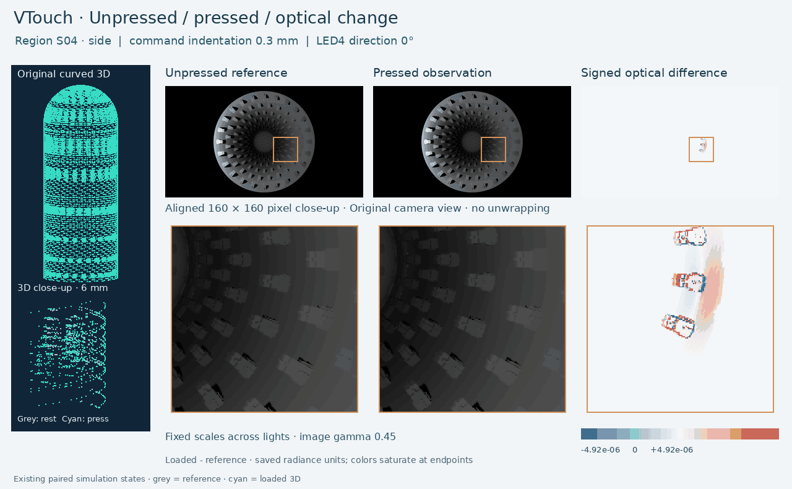
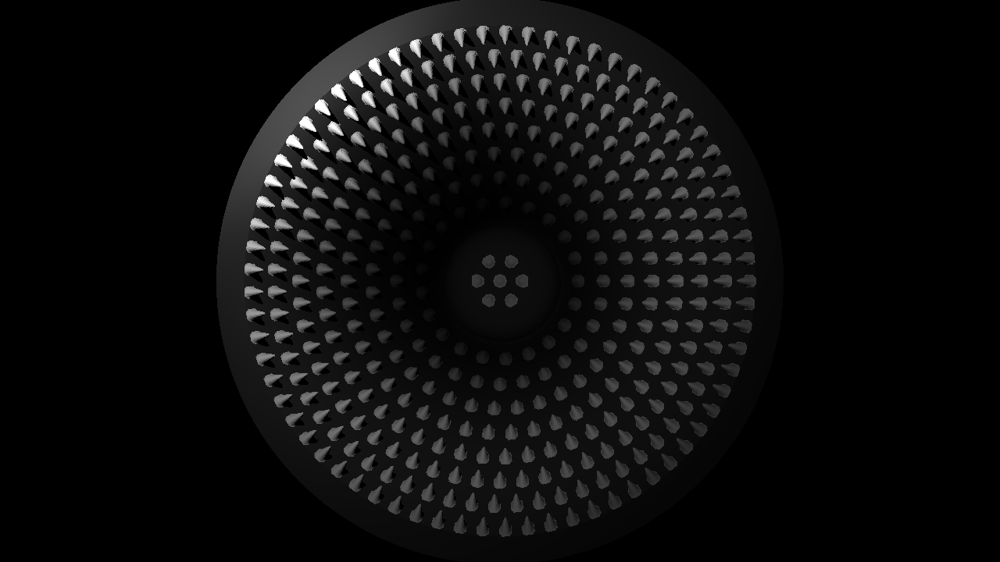

# VTouch: simulation and recognition benchmark companion

[English](README.md) | [中文](README.zh-CN.md)

A compact, self-contained interactive companion for two linked studies on hollow curved vision-based tactile sensors.

**[Open the English paper companion](https://115.159.42.27:8088/vtouch/papers/en/)** · **[中文交互展示](https://115.159.42.27:8088/vtouch/papers/zh/)** · [Complete ABC research platform](https://115.159.42.27:8088/vtouch/)

**[GitHub repository](https://github.com/googo2025/vtouch-simulation-benchmark)** · **[GitHub Pages](https://googo2025.github.io/vtouch-simulation-benchmark/)**

The GitHub Pages copy is in **docs/**. It uses relative asset paths and runs without the research server, external CDNs, or model execution. The Tencent entry retains the larger ABC collection.

## Quick visual preview

The animation compares paired existing reference and pressed states in two regions and four LED4 directions (0°, 12°, 34°, 60°). It preserves the native camera projection, shows the same 160×160-pixel close-up in each row, and uses one signed optical-difference color scale across all frames. Observation images share a fixed gamma of 0.45; raw values are used for the difference. Grey/cyan 3D overlays use original coordinates with no displacement amplification.

**Rotate a simple 3D example:** [Round end](https://googo2025.github.io/vtouch-simulation-benchmark/en/?shape=round#1) · [Paired tips](https://googo2025.github.io/vtouch-simulation-benchmark/en/?shape=paired#1) · [Cross lines](https://googo2025.github.io/vtouch-simulation-benchmark/en/?shape=cross_lines#1)

[Complete ABC collection on Tencent Cloud](https://115.159.42.27:8088/vtouch/). The static geometry-only rotation remains available in docs/assets/paper-three-geometries.gif.

## Revised manuscripts and supplements

| Paper | Highlighted revision | Supplement |
|---|---|---|
| A | [PDF](docs/downloads/papers/PaperA_Revised_highlighted.pdf) · [Word](docs/downloads/papers/PaperA_Revised_highlighted.docx) | [PDF](docs/downloads/papers/PaperA_Supplementary_material.pdf) · [Word](docs/downloads/papers/PaperA_Supplementary_material.docx) |
| B | [PDF](docs/downloads/papers/PaperB_Revised_highlighted.pdf) · [Word](docs/downloads/papers/PaperB_Revised_highlighted.docx) | [PDF](docs/downloads/papers/PaperB_Supplementary_methods.pdf) · [Word](docs/downloads/papers/PaperB_Supplementary_methods.docx) |

These are revised author drafts; author details remain for completion by the authors.

## Four focused displays

| Entry | What can be explored |
|---|---|
| A1 — Morphology and observability | Three rotatable examples from fifteen surface morphologies, sampled geometry, original height maps, eleven exact camera-matched examples, and saved region–depth–condition comparisons. |
| A2 — Loaded surface and optical change | Four existing V2 representative loaded states, their exact saved reference, two illumination directions, rotatable original-coordinate point displays, full 1280×720 optical arrays, and aligned crops/differences. |
| B1 — Saved inputs and predictions | Twelve original/nested saved runs: one fixed seed, two tilts, three held-location groups per stage; 48 original input images and all 64 saved predictions per condition. |
| B2 — Illumination and baselines | The complete saved 16-row regional summary across four illumination directions, with metric selection and the original full-condition CSVs. |

## How the studies fit together

**Paper A** establishes the mechanics–optics simulation framework, source traceability, numerical verification and region-wise morphology comparison. Its quantitative fifteen-morphology results are distinct from the shared V2 loading illustration in A2.

**Paper B** establishes location-grouped evaluation, basic detection/localization baselines, illumination comparisons and the original/nested development record. Later nested replays share inputs and may reuse byte-identical predictions; they are not fresh independent confirmation experiments.

**C** is the continuing simulation-based research programme for stronger detection, localization, indentation/deformation recognition and design selection. Its complete research materials remain organized on the ABC platform.

## Reuse and evidence

- Meshes are subsampled **only for display** (A1: every fourth vertex; A2: every sixth triangle-corner vertex). These exports are not full-resolution training datasets.
- Selected optical arrays and mean reference arrays are losslessly gzip-compressed. Saved input PNGs are copied byte-for-byte.
- Original command coordinates and indentation labels retain their nominal meanings. Illumination variants and noise realizations share physical sources.
- In B1 only the first input frame is bundled; all 64 saved prediction values are retained. Full-condition tables are not reduced to this display selection.
- Source and export SHA-256 identities are recorded in provenance/. No simulation, training, inference or new recognition feature extraction was run to build this companion.

## Repository layout

- docs/ — self-contained bilingual static site and selected assets
- paper-a/ — A scope, result index and publication status
- paper-b/ — B scope, baseline code/results and publication status
- code/historical/ — six exact existing B producer/baseline scripts, with source identities
- configs/ and environment/ — retained configuration/environment records where present
- provenance/ — finite selection, source/export identities and runtime record
- tools/verify_release.py — verify packaged bytes and static references
- UPLOAD.md — GitHub and Pages setup
- RELEASE_CHECKLIST.md — remaining publication decisions

## Local preview

Serve docs/ over HTTP rather than opening the HTML with a file URL:

    python -m http.server 8000 --directory docs

Then open http://localhost:8000/. English is the default, with a Chinese switch.

## Publication status

This is a **prepared review package**. Highlighted manuscript and supplementary revision drafts are linked above. Author details, final citation and licensing decisions remain to be completed. Historical scripts are preserved rather than silently rewritten into a new simulator. Paper A's exact end-to-end simulator producer is still a release-completeness item; the six included historical scripts belong to B.

The scientific source datasets and original results remain unchanged.

Display renderer: tools/render_press_comparison.py. Exact public source-export links and hashes: provenance/press-preview-source-map.json.
