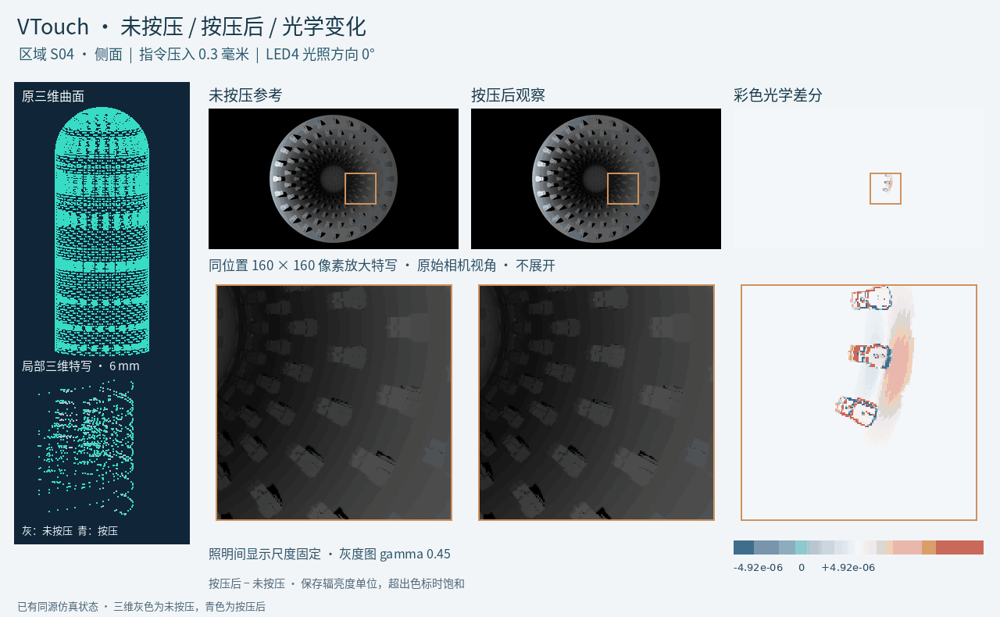

# VTouch：仿真与识别基线论文资料包

[English](README.md) | [中文](README.zh-CN.md)

[打开论文精简交互](https://115.159.42.27:8088/vtouch/papers/zh/) · [完整ABC平台](https://115.159.42.27:8088/vtouch/)

本资料包用于A、B两篇论文的核心证据浏览。腾讯云保留完整43项ABC交互；GitHub版集中为4个入口，数据随包保存，可独立部署到GitHub Pages。

## 修订论文与补充材料

| 论文 | 黄标修订稿 | 补充材料 |
|---|---|---|
| A | [PDF](docs/downloads/papers/PaperA_Revised_highlighted.pdf) · [Word](docs/downloads/papers/PaperA_Revised_highlighted.docx) | [PDF](docs/downloads/papers/PaperA_Supplementary_material.pdf) · [Word](docs/downloads/papers/PaperA_Supplementary_material.docx) |
| B | [PDF](docs/downloads/papers/PaperB_Revised_highlighted.pdf) · [Word](docs/downloads/papers/PaperB_Revised_highlighted.docx) | [PDF](docs/downloads/papers/PaperB_Supplementary_methods.pdf) · [Word](docs/downloads/papers/PaperB_Supplementary_methods.docx) |

以上为现有修订稿；作者身份信息按约定由作者自行补充。

| 入口 | 内容 |
|---|---|
| A1 形貌与可观测性 | 15种形貌的保存结果、3种简易可旋转点云、原高度图和匹配相机画面、原保存区域—深度—条件比较。 |
| A2 按压三维与图像变化 | 已有V2四个代表区域、原参考、两种照明方向、1280×720原光学数组、同位置放大与差分。该共享示例与A的15形貌定量库分别注明来源。 |
| B1 输入与识别结果 | 固定种子1701、两种光照、原始与嵌套阶段共12组保存模型记录，48张原输入图及每条件64条保存预测。 |
| B2 照明与基线比较 | 四种照明方向的完整16行区域汇总和原始完整条件CSV。 |

三维仅作显示抽稀，原坐标和高度不改；光学数组采用无损压缩。噪声实现、光照变化及模型版本共享物理来源。所有原名义坐标、指令压入量保留原含义。B中历史留出结果按开发回测呈现。

A负责仿真、复核与形貌选型；B负责分组评价与识别基线；C为后续仿真数据上的识别方法和方案优选系列。完整研究范围仍可在ABC平台查看。

README.md为默认英文说明。docs/是可独立运行的中英文静态站点；paper-a/与paper-b/分别索引论文、结果和代码；provenance/保存来源和导出指纹；UPLOAD.md给出上传及Pages设置步骤。

本资料包的目标仓库为 googo2025/vtouch-simulation-benchmark；在线部署状态以该仓库与GitHub Pages实际结果为准。身份信息由作者自行补充。A的原始端到端仿真生产源码仍在公开完整性待办中；已收入的六份历史脚本属于B。正文修订稿另在私有审阅入口保存。

## 直观预览

动图展示两个区域已有未按压与按压状态，以及LED4的0°、12°、34°、60°照明方向。采用原相机视角、不展开；同位置160×160像素特写对齐。全部帧共用彩色光学差分色标；灰度显示统一gamma 0.45，差分直接用原数值。三维灰色为未按压、青色为按压后，原坐标不放大形变。

**点击旋转简易三维：** [圆端](https://googo2025.github.io/vtouch-simulation-benchmark/zh/?shape=round#1) · [成对尖端](https://googo2025.github.io/vtouch-simulation-benchmark/zh/?shape=paired#1) · [交叉线](https://googo2025.github.io/vtouch-simulation-benchmark/zh/?shape=cross_lines#1)

[腾讯云完整ABC平台](https://115.159.42.27:8088/vtouch/zh/)。原三种结构的旋转动图另保留在 docs/assets/paper-three-geometries.gif。

动图显示源码：tools/render_press_comparison.py；已有公开源导出链接及指纹：provenance/press-preview-source-map.json。
